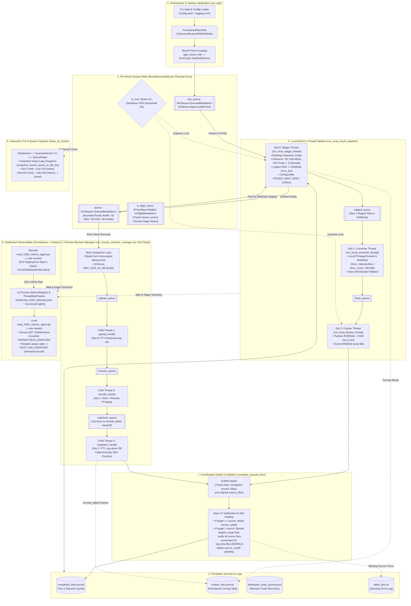

# Diagram 1: Swimlane & Pipeline Topology

This diagram illustrates the spatial architecture of [**Rusty H.265 Converter**](../src/main.rs), showing how the orchestrator groups input directories by physical mount point, feeds raw files through the per-mount 3-thread local pipeline (`Slot 0` Stager, `Slot 1` Converter, `Slot 2` Flusher) and 3-thread remote SSH managers (`upload_handle`, `encode_handle`, `copyback_handle`), and exposes a detached deep-copy snapshot to the interactive TUI Queue Viewer (`'v'`).

* **Parent Document**: [SOFTWARE_ARCHITECTURE_AND_DESIGN.md](SOFTWARE_ARCHITECTURE_AND_DESIGN.md)
* **Declarative D2 Version**: [01_pipeline_topology.d2](01_pipeline_topology.d2) (renderable with [D2](https://d2lang.com/tour/intro/))
* **Mermaid Syntax Reference**: [Mermaid Flowcharts](https://mermaid.js.org/syntax/flowchart.html)

