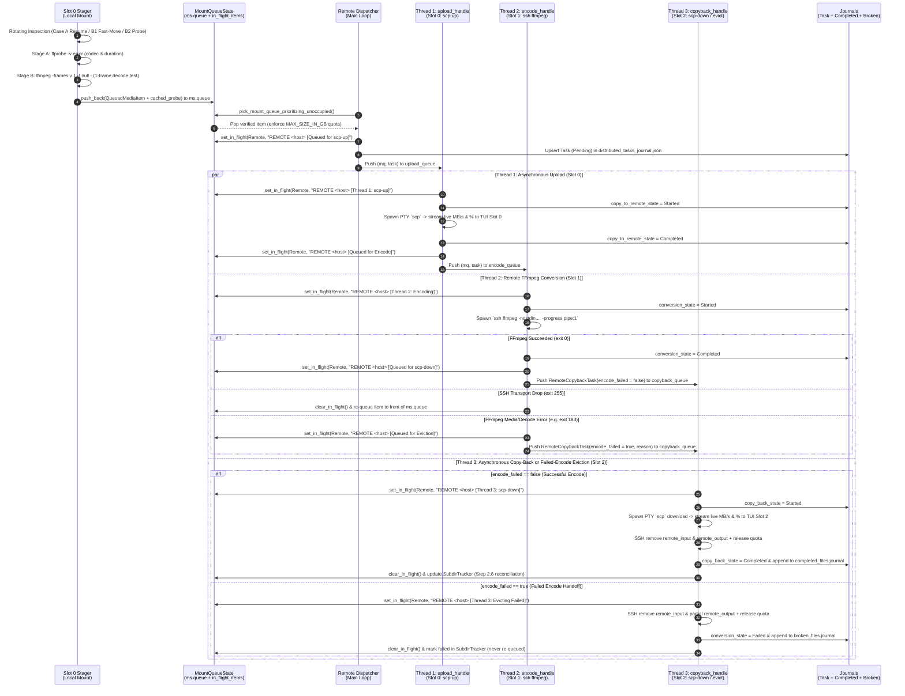

# Diagram 2: Parallel Sequence Diagram (Remote 3-Thread Pipeline, Failure Handoff & Work Stealing)

This sequence diagram illustrates how a Remote Machine Manager (`run_remote_machine_manager` in [src/main.rs](../src/main.rs)) coordinates with the per-mount `Slot 0` Stager (`run_local_stager_thread`) and overlaps its three child threads (`upload_handle`, `encode_handle`, and `copyback_handle`). When a remote FFmpeg encode fails due to a non-SSH media error, `encode_handle` hands off cleanup (`encode_failed: true`) to `copyback_handle` via `copyback_queue` so `Slot 1` immediately starts encoding the next queued file while `Slot 2` asynchronously evicts the remote input/output files and records the failure in `broken_files.journal`.

* **Parent Document**: [SOFTWARE_ARCHITECTURE_AND_DESIGN.md](SOFTWARE_ARCHITECTURE_AND_DESIGN.md)
* **Mermaid Syntax Reference**: [Mermaid Sequence Diagrams](https://mermaid.ai/open-source/syntax/sequenceDiagram.html)

