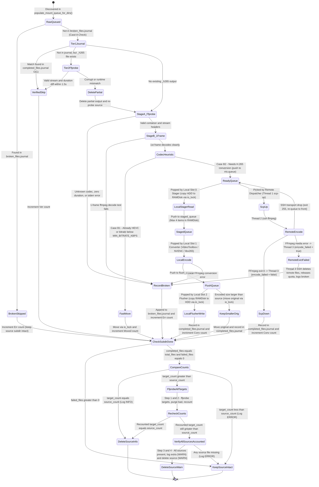

# Diagram 3: Media Item & Subdirectory Reconciliation State Machine

This state machine diagram traces the complete lifecycle of a media file and its parent subdirectory in [src/main.rs](../src/main.rs)—from initial discovery in `raw_queue`, through the `Slot 0` Stager's rotating queue inspection (`completed_files.journal`, `broken_files.journal`, `ffprobe -v error`, and 1-frame decode test), local 3-thread (`Stager` -> `Converter` -> `Flusher`) or remote 3-thread (`scp-up` -> `ssh ffmpeg` -> `scp-down` / eviction) conversion, and finally Step 2.6 subdirectory completion and `target_count > source_count` self-healing reconciliation.

* **Parent Document**: [SOFTWARE_ARCHITECTURE_AND_DESIGN.md](SOFTWARE_ARCHITECTURE_AND_DESIGN.md)
* **Mermaid Syntax Reference**: [Mermaid Flowcharts & State Diagrams](https://mermaid.js.org/syntax/flowchart.html)

