# Diagram 4: Multi-Threaded Execution Timeline & I/O Serialization Waterfall

This timeline waterfall diagram illustrates how [src/main.rs](../src/main.rs) overlaps local 3-thread pipeline stages (`Slot 0` Stager, `Slot 1` Converter, `Slot 2` Flusher) and remote 3-thread pipeline stages (`scp-up`, `ssh ffmpeg`, `scp-down`) in time while strictly serializing mechanical hard drive reads and writes through the per-mount `io_lock` mutex.

* **Parent Document**: [SOFTWARE_ARCHITECTURE_AND_DESIGN.md](SOFTWARE_ARCHITECTURE_AND_DESIGN.md)
* **Mermaid Syntax Reference**: [Mermaid Timeline / Gantt Syntax](https://mermaid.js.org/syntax/timeline.html)
* **Interactive Trace Viewer**: [Perfetto UI](https://perfetto.dev/docs/visualization/perfetto-ui)

```mermaid
gantt
    title Multi-Threaded 3-Stage Local & Remote Pipeline Overlap (HDD Mount + RAMDisk + Remote Node)
    dateFormat  HH:mm:ss
    axisFormat  %S s

    section Local Slot 0 (Stager)
    Inspect & Probe File A (ffprobe + 1f-Decode) :active, v1, 00:00:00, 00:00:01
    File A - Stage Read (HDD to RAMDisk)         :        s0r1, 00:00:01, 00:00:04
    Inspect & Probe File B (ffprobe + 1f-Decode) :active, v2, 00:00:04, 00:00:05
    File B - Stage Read (HDD to RAMDisk)         :        s0r2, 00:00:05, 00:00:08
    Inspect File C (Tier-1 Journal Hit)          :done,   v3, 00:00:08, 00:00:09
    Inspect & Probe File D (Push to Ready Queue) :active, v4, 00:00:09, 00:00:10
    Inspect File E (Corrupt - broken.journal)    :crit,   v5, 00:00:10, 00:00:11
    Inspect & Probe File F (Push to Ready Queue) :active, v6, 00:00:11, 00:00:12

    section HDD io_lock (Mutex)
    File A - HDD to RAMDisk Read (Slot 0)        :crit,   io1, 00:00:01, 00:00:04
    File B - HDD to RAMDisk Read (Slot 0)        :crit,   io2, 00:00:05, 00:00:08
    File A - RAMDisk to HDD Write (Slot 2)       :crit,   io3, 00:00:14, 00:00:16
    File B - RAMDisk to HDD Write (Slot 2)       :crit,   io4, 00:00:24, 00:00:26

    section Local Slot 1 (Converter)
    Wait for First Staged File                   :        s1w, 00:00:00, 00:00:04
    File A - VideoToolbox H.265 Encode (RAMDisk) :active, s1e1, 00:00:04, 00:00:14
    File B - VideoToolbox H.265 Encode (RAMDisk) :active, s1e2, 00:00:14, 00:00:24

    section Local Slot 2 (Flusher)
    Idle (Waiting on flush_queue)                :        s2w, 00:00:00, 00:00:14
    File A - Flush Write (RAMDisk to HDD)        :        s2f1, 00:00:14, 00:00:16
    File B - Flush Write (RAMDisk to HDD)        :        s2f2, 00:00:24, 00:00:26

    section Remote Node (3 Threads)
    File D - Thread 1 scp-up (LAN to Remote)     :        ru1, 00:00:10, 00:00:14
    File F - Thread 1 scp-up (LAN to Remote)     :        ru2, 00:00:14, 00:00:18
    File D - Thread 2 Remote FFmpeg Encode       :active, re1, 00:00:14, 00:00:22
    File F - Thread 2 Remote FFmpeg Encode       :active, re2, 00:00:22, 00:00:30
    File D - Thread 3 scp-down (Remote to LAN)   :        rd1, 00:00:22, 00:00:25
    File F - Thread 3 scp-down (Remote to LAN)   :        rd2, 00:00:30, 00:00:33
```

