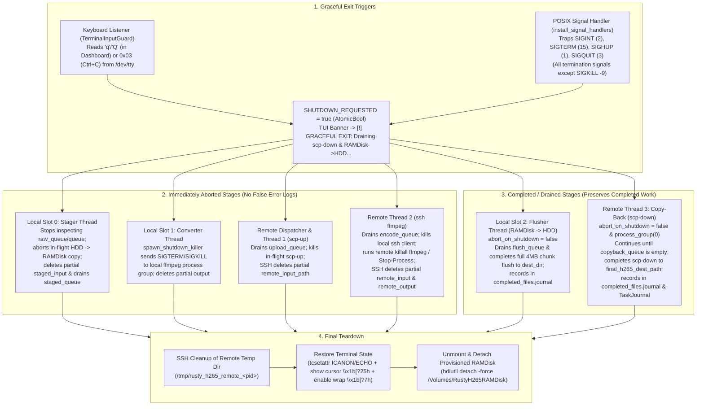

# Diagram 5: Graceful Shutdown & Signal Handling Flow

This diagram details what happens inside [src/main.rs](../src/main.rs) when the user presses `'q'` (on the Dashboard) or `Ctrl+C`, or when the process receives `SIGINT`, `SIGTERM`, `SIGHUP`, or `SIGQUIT`. In-flight uploads (`scp-up`), staging reads (`HDD -> RAMDisk`), and `ffmpeg` encodes are aborted and cleaned up immediately without polluting `failed_dirs.txt` or `broken_files.journal`, while completed encodes currently flushing via `scp-down` or `RAMDisk -> HDD` (`Slot 2` Flusher) are allowed to finish and record into `completed_files.journal`.

* **Parent Document**: [SOFTWARE_ARCHITECTURE_AND_DESIGN.md](SOFTWARE_ARCHITECTURE_AND_DESIGN.md)
* **Mermaid Syntax Reference**: [Mermaid Flowcharts](https://mermaid.js.org/syntax/flowchart.html)

