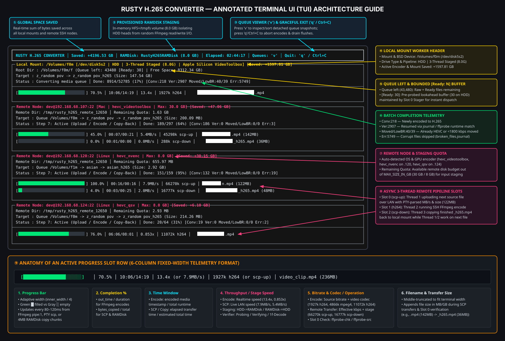
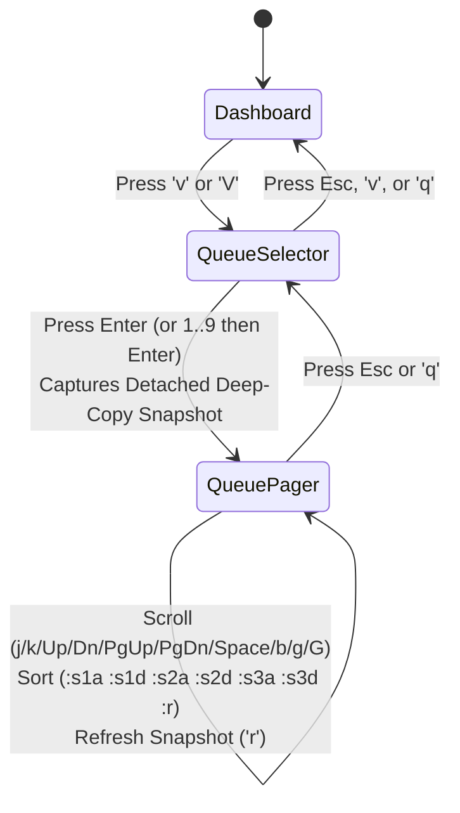

# Diagram 6: Annotated Terminal UI (TUI) Field Reference & Interactive Queue Guide



This guide explains every field and interactive view mode in the **Rusty H.265 Converter** Terminal UI (`draw_tui_frame` in [src/main.rs](../src/main.rs)), including the main **Dashboard**, the **Queue Selector Dropdown (`'v'`)**, and the **`less`-Style Sortable Queue Viewer (`QueuePager`)**.

* **Parent Document**: [SOFTWARE_ARCHITECTURE_AND_DESIGN.md](SOFTWARE_ARCHITECTURE_AND_DESIGN.md)
* **Annotated Vector Diagram**: [06_tui_annotated_guide.svg](06_tui_annotated_guide.svg)

---

## 1. Field-by-Field Dashboard Reference

### ①–③ Top Global Banner (`╔═══...═══╗`)
| Field | Example in Screenshot | Meaning |
| :--- | :--- | :--- |
| **Application Title** | `RUSTY H.265 CONVERTER` | Active application banner (turns bold yellow `[!] GRACEFUL EXIT: Draining scp-down & RAMDisk->HDD...` when shutting down). |
| **① `Saved: +X.XX GB`** | `Saved: +4196.53 GB` | Cumulative disk space saved across **all** local mount workers and remote SSH nodes (`sum(w.bytes_saved_total)`). |
| **② `RAMDisk: ...`** | `RAMDisk: RustyH265RAMDisk (8.0 GB @ /Volumes/RustyH265RAMDisk)` | Name, provisioned capacity, and mount path of the in-memory staging volume used by local workers to prevent HDD head thrashing. |
| **③ `Elapsed: HH:MM:SS`** | `Elapsed: 02:44:17` | Total wall-clock runtime since orchestrator startup. |
| **③ `Queues: 'v'`** | `Queues: 'v'` | Opens the interactive **Queue Selector** dropdown to inspect active & queued files per mount point. |
| **③ `Quit: 'q' / Ctrl+C`** | `Quit: 'q' / Ctrl+C` | Interactive graceful-shutdown shortcut (`TerminalInputGuard` + POSIX signal trap for `SIGINT`, `SIGTERM`, `SIGHUP`, `SIGQUIT`). |

---

### ④–⑥ Local Mount Worker Box (Yellow Header — `local:<mount_point>`)
Each physical drive mount (`/Volumes/f0m`, `/Volumes/f1m`) runs its own dedicated 3-thread local pipeline (`Slot 0` Stager, `Slot 1` Converter, `Slot 2` Flusher):

| Line / Field | Example in Screenshot | Meaning |
| :--- | :--- | :--- |
| **④ Box Header** | `Local Mount: /Volumes/f0m [/dev/disk5s2 \| HDD \| 3-Thread Staged (8.0G) \| Apple Silicon VideoToolbox] [Saved: +1597.81 GB]` | Displays the mount point, underlying BSD disk device (`/dev/disk5s2`), auto-detected media type (`HDD` / `SSD` / `NVMe`), active 3-thread staging mode (`3-Thread Staged (8.0G)`), local hardware encoder profile (`Apple Silicon VideoToolbox`), and space saved on this specific drive. |
| **⑤ `Root Dir`** | `/Volumes/f0m/f (Queue left: 43480 [Ready: 30] \| Free Space: 8312.34 GB)` | Current CLI root directory being processed, total remaining files (`raw_queue + queue`), bounded pre-verified lookahead count (`[Ready: 30]` maintained by `Slot 0` Stager), and live free space on the drive. |
| **`Target`** | `z_random pov -> z_random pov_h265 (Size: 147.54 GB)` | Current source subdirectory being converted into its `_h265` target subdirectory and the total byte size of that source subdirectory. |
| **⑥ `Status` & `Done`** | `Converting media queue \| Done: 8914/52785 (17%)` | Current worker phase and overall file completion progress (`batch_completed_files / batch_total_files`). |
| **⑥ `[Conv:N Ver:N Moved/LowBR:N/N Err:N]`** | `[Conv:218 Ver:2907 Moved/LowBR:40/39 Err:5749]` | • **`Conv`**: Newly encoded to H.265 `.mp4`.<br/>• **`Ver`**: Existing `_h265` outputs verified and skipped via Tier-1 `completed_files.journal` or Tier-2 `ffprobe` runtime match.<br/>• **`Moved/LowBR`**: Already-HEVC or low-bitrate (`< MIN_BITRATE_KBPS`) files fast-moved without re-encoding.<br/>• **`Err`**: Corrupt/unreadable files recorded in `broken_files.journal` and skipped. |
| **Concurrent Pipeline Slots (`0..2`)** | **Slot 0 (`Stager`)**, **Slot 1 (`Converter`)**, **Slot 2 (`Flusher`)** | • **Slot 0 (`Stager`)**: Rotating queue inspection (`ffprobe-chk`, `ffprobe-src`, `1f-Decode`, fast-move) and `HDD -> RAMDisk` staging copy (`staged_queue` max 4 items; waits `STAGER_WAIT_MSEC` when full/idle).<br/>• **Slot 1 (`Converter`)**: Local hardware FFmpeg H.265 encode inside RAMDisk.<br/>• **Slot 2 (`Flusher`)**: Sequential `RAMDisk -> HDD` write-back under `io_lock`. |

---

### ⑦–⑧ Remote Node Worker Box (Magenta Header — `remote:<user>@<ip>`)
Each remote SSH machine configured in [config.yaml](../config.yaml) (`192.168.68.107`, `192.168.68.120`, `192.168.68.124`) gets its own worker box:

| Line / Field | Example in Screenshot | Meaning |
| :--- | :--- | :--- |
| **⑦ Box Header** | `Remote Node: dev@192.168.68.120:22 [Linux \| hevc_nvenc \| Max: 8.0 GB] [Saved: +30.15 GB]` | SSH target (`user@host:port`), detected remote OS (`Mac` / `Linux` / `Windows`), verified hardware HEVC encoder (`hevc_videotoolbox`, `hevc_nvenc`, `hevc_qsv`), configured input staging cap (`Max: 8.0 GB`), and total bytes saved by this node. |
| **⑦ `Remote Dir` & `Remaining Quota`** | `/tmp/rusty_h265_remote_12650 \| Remaining Quota: 655.97 MB` | Ephemeral remote working directory (`PID`-isolated) and remaining byte quota (`MAX_SIZE_IN_GB - remote_used_input_bytes`) before the dispatcher pauses new uploads. |
| **`Target`** | `Queue /Volumes/f1m -> asian -> asian_h265 (Size: 2.92 GB)` | Shows which local mount queue (`/Volumes/f0m` or `/Volumes/f1m`) and subdirectory the remote node stole its current task from, plus the task's file size. |
| **⑧ Concurrent Pipeline Rows** | `scp-up` (Slot 0), `h264`/`mpeg4` (Slot 1), `scp-down` (Slot 2) | Up to 3 simultaneous rows corresponding to the 3 asynchronous child threads per remote node:<br/>• **Slot 0 (`scp-up`)**: Thread 1 uploading the next source video over LAN.<br/>• **Slot 1 (`h264`/`mpeg4`)**: Thread 2 encoding the current video on the remote GPU over SSH.<br/>• **Slot 2 (`scp-down` / `rm-failed`)**: Thread 3 copying the finished `_h265.mp4` back to the local drive (or evicting remote input/output files when handed an `encode_failed` task from Thread 2). |

---

### ⑨ Active Slot Progress Row Format (6 Columns)
Every active operation row inside a Local or Remote box follows a unified 6-column telemetry layout:

```text
│ [██████████████░░░░░░]  70.5% │ 10:06/14:19 │       13.4x │  1927k h264 │ filename.mp4 (142MB) │
```

1. **`[████░░]` Progress Bar**: Adaptive width (`(inner_width / 4).clamp(16, 48)`), rendered in green (`\x1b[32m█`) and dark gray (`\x1b[90m░`).
2. **`70.5%` Completion Percentage**: Derived from `out_time_us / probe.duration_secs` during FFmpeg encoding, or `copied_bytes / expected_bytes` during `scp` and RAMDisk staging copies.
3. **`10:06/14:19` Time Window**:
   * *During FFmpeg encode*: `encoded_media_timestamp / total_video_duration` (e.g., `10:06` of a `14:19` video).
   * *During SCP or RAMDisk I/O*: `elapsed_transfer_time / estimated_total_transfer_time` (e.g., `00:07/00:21`).
4. **`13.4x` / `5.4MB/s` Speed Indicator**:
   * *During FFmpeg encode*: Real-time encoding speed multiplier (`13.4x`, `11.3x`, `0.853x`).
   * *During SCP transfer*: Live network throughput (`5.4MB/s`, `7.9MB/s`, `2.0MB/s`) parsed from PTY `scp` output.
   * *During Local Staging / Flushing*: Disk transfer direction and speed (`HDD->RAMDisk 185M/s`, `RAMDisk->HDD 210M/s`).
   * *During `Slot 0` Stager Inspection*: `Verifying` (`ffprobe-chk`), `Probing` (`ffprobe-src`), `Validating` (`1f-Decode`), or `Moving`.
5. **`1927k h264` Bitrate & Codec / Stage Label**:
   * *During FFmpeg encode*: Source bitrate in kbps and source video codec (`1927k h264`, `4866k mpeg4`, `11072k h264`).
   * *During SCP transfer*: Effective transfer rate in kbps and transfer direction (`45298k scp-up`, `16777k scp-down`).
6. **`filename.mp4 (142MB)` Target Filename & Size**: Middle-truncated using display-column width (`str_display_width`) to fit the terminal width, with the file's byte size (`142MB` input vs. `36MB` H.265 output) appended during remote transfers and verification.

---

## 2. Interactive Queue Selector (`'v'`) & `less`-Style Queue Viewer (`QueuePager`)

The TUI supports three interactive view modes (`TuiViewMode` in [src/main.rs](../src/main.rs)):
1. **`Dashboard`** (Default live worker telemetry view)
2. **`QueueSelector`** (Interactive dropdown list of mount queues)
3. **`QueuePager`** (`less`-style scrollable & sortable snapshot viewer)



### 2.1 Queue Selector Mode (`QueueSelector`)
Pressing `'v'` on the Dashboard opens the **Select a Mount Queue to Inspect** view:
* Lists every discovered physical mount queue with its `[#]` index, mount path, `DriveType` (`HDD` / `SSD` / `NVMe`), root directory, active in-flight count, queued count (`[Ready: N]`), and total size in GB.
* **Keybindings**:
  * `Up` / `Down` or `j` / `k` (or `1`–`9`): Move selection cursor (`>`).
  * `Enter`: Capture a **detached deep-copy snapshot** (`snapshot_mount_queue_to_flat_list`) of the selected mount queue and open `QueuePager`.
  * `Esc`, `'v'`, or `'q'`: Return to the live `Dashboard`.

### 2.2 `less`-Style Sortable Queue Viewer (`QueuePager`)
Entering a mount queue constructs an isolated `QueueSnapshotView` containing a cloned flat `Vec<QueueViewEntry>` built from:
1. **`ms.in_flight_items`** (files actively being processed by local `Stager`/`Converter`/`Flusher` threads or remote `scp-up`/`encode`/`scp-down` threads)
2. **`ms.queue`** (verified ready-to-encode lookahead queue)
3. **`ms.raw_queue`** (unverified files awaiting `Slot 0` Stager inspection)

Because `QueueSnapshotView` is a detached deep copy, scrolling and sorting inside `QueuePager` never holds a lock on `MountQueueState` and never interferes with live worker scheduling.

#### Header & 3-Column Table Layout
```text
╔══════════════════════════════════════════════════════════════════════════════════════════════════════════════╗
║ Queue of files from root: /Volumes/f1m/f at 8:43:38.709 pm. Total: 4304 files (62 active, 4242 queued | ...) ║
║ Mount: /Volumes/f1m (HDD) | Sort: Original Queue Order (:r) | Scroll: Up/Dn/j/k/PgUp/PgDn/Space/b/g/G | ...  ║
╠══════════════════════════════════════════════════════════════════════════════════════════════════════════════╣
║     #  [1] File Name / Path                                       |   [2] Size | [3] Status / Worker         ║
╠══════════════════════════════════════════════════════════════════════════════════════════════════════════════╣
║     1  meangirls/AMG Part 1/Carmela - Carmela's Choice.mp4        |  887.89 MB | LOCAL [Converter: Encoding] ║
║     2  meangirls/AMG Part 1/Beverly Platinum - Mean Girl.mp4      |  845.34 MB | LOCAL [Staged: Waiting Conv]║
║     4  meangirls/American Mean Girls - Suffer For My New.mp4      |  881.52 MB | REMOTE 192.168.68.103 [...] ║
║    63  meangirls/Some Pending Video.mp4                           |  712.10 MB | QUEUED [Ready]              ║
║    93  meangirls/Unprobed Video.mp4                               |  640.00 MB | QUEUED [Pending Probe]      ║
╚══════════════════════════════════════════════════════════════════════════════════════════════════════════════╝
```

* **Column 1 (`[1] File Name / Path`)**: Path relative to the mount's root directory (middle-truncated to fit the column width).
* **Column 2 (`[2] Size`)**: Human-readable file size (`MB` / `GB`), sorted numerically by `size_bytes`.
* **Column 3 (`[3] Status / Worker`)**: Plain-text, ANSI-color-coded worker/queue status:
  * **Bold Green (`LOCAL [...]`)**: Active on the local mount's 3-thread pipeline (`LOCAL [Stager: Inspecting]`, `LOCAL [Stager: Copying to RAMDisk]`, `LOCAL [Staged: Waiting Conv]`, `LOCAL [Converter: Encoding]`, `LOCAL [Staged: Waiting Flush]`, `LOCAL [Flusher: Writing to Disk]`).
  * **Bold Magenta (`REMOTE <host> [...]`)**: Active on a remote SSH node (`REMOTE <host> [Queued for scp-up]`, `REMOTE <host> [Thread 1: scp-up]`, `REMOTE <host> [Queued for Encode]`, `REMOTE <host> [Thread 2: Encoding]`, `REMOTE <host> [Queued for scp-down]`, `REMOTE <host> [Thread 3: scp-down]`, `REMOTE <host> [Thread 3: Evicting Failed]`).
  * **Cyan (`QUEUED [Ready]`)**: Verified by `Slot 0` Stager and waiting in `ms.queue`.
  * **Dim Gray (`QUEUED [Pending Probe]`)**: Waiting in `ms.raw_queue` for `Slot 0` Stager inspection.

#### Navigation & `:s<col><a|d>` Sort Commands
| Key / Command | Action |
| :--- | :--- |
| `j` / `Down Arrow` | Scroll down 1 line |
| `k` / `Up Arrow` | Scroll up 1 line |
| `Space` / `f` / `PgDn` | Page down (`page_rows` lines) |
| `b` / `PgUp` | Page up (`page_rows` lines) |
| `d` / `u` | Half-page down / Half-page up |
| `g` / `Home` | Jump to top of list (line 1) |
| `G` / `End` | Jump to bottom of list |
| `r` | Capture a fresh detached snapshot of the current mount queue (preserving current sort spec) |
| `:s1a` + `Enter` | Sort by **Column 1 (`File Name / Path`)** Ascending (`(ASC)`) |
| `:s1d` + `Enter` | Sort by **Column 1 (`File Name / Path`)** Descending (`(DESC)`) |
| `:s2a` + `Enter` | Sort by **Column 2 (`Size`)** Ascending (`(ASC)`) |
| `:s2d` + `Enter` | Sort by **Column 2 (`Size`)** Descending (`(DESC)`) |
| `:s3a` + `Enter` | Sort by **Column 3 (`Status / Worker`)** Ascending (`LOCAL` -> `REMOTE` -> `QUEUED [Ready]` -> `QUEUED [Pending Probe]`) |
| `:s3d` + `Enter` | Sort by **Column 3 (`Status / Worker`)** Descending |
| `:r` + `Enter` | Reset sort back to **Original Queue Order** (`orig_index`) |
| `Esc` or `q` | Exit `QueuePager` back to `QueueSelector` |
