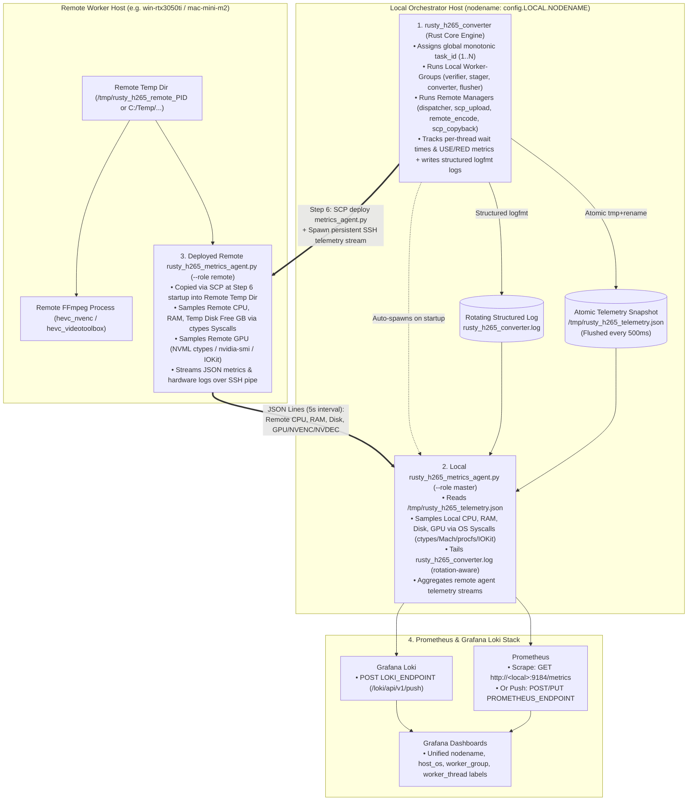
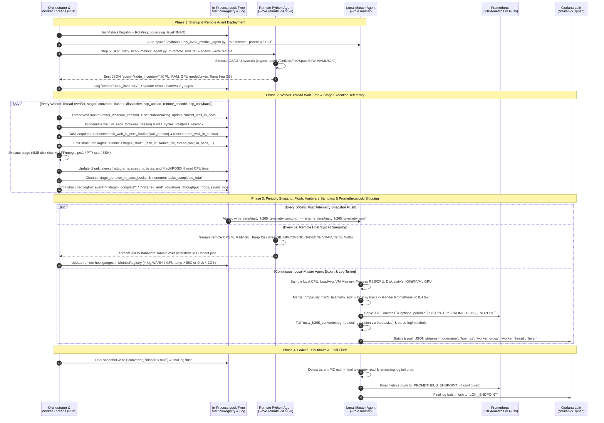
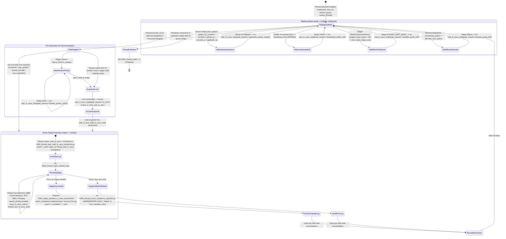
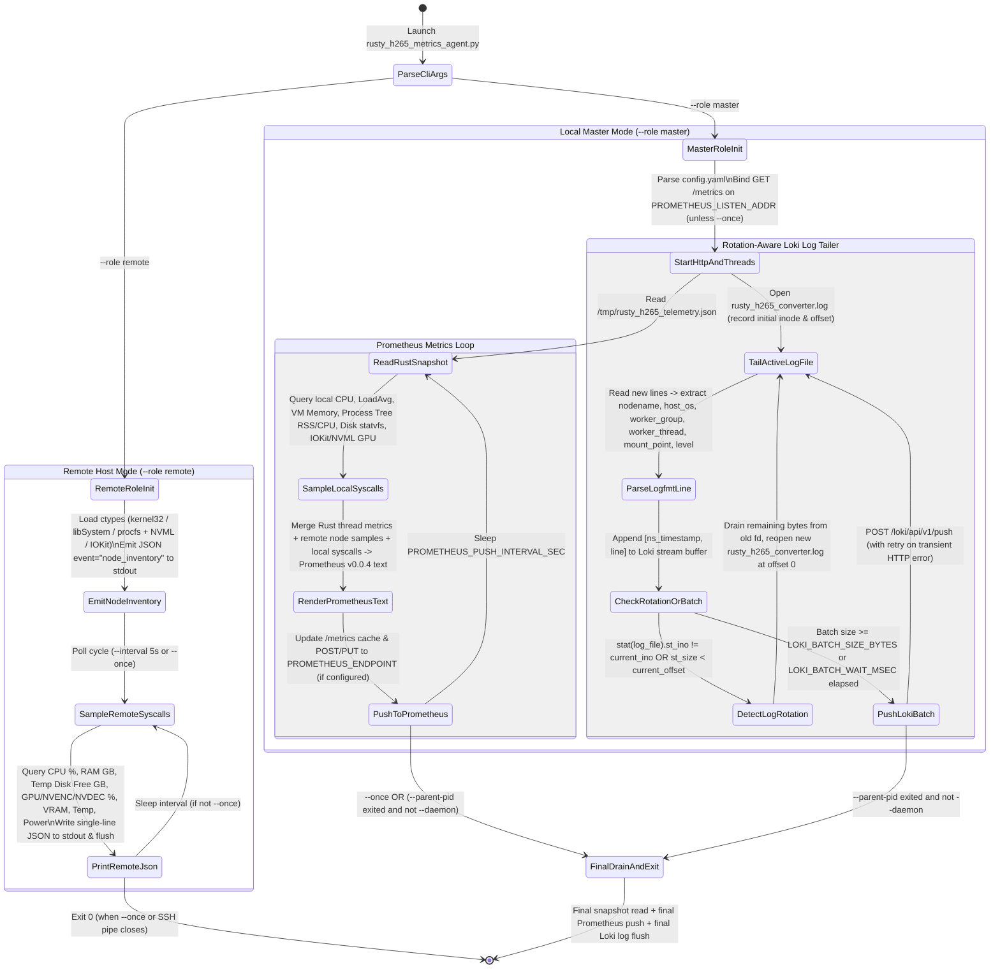

# Diagram 7: Observability Architecture — Prometheus Metrics, Per-Thread Wait Tracking & Grafana Loki Log Shipping

This document details the end-to-end observability architecture of [**Rusty H.265 Converter**](../src/main.rs), covering:
1. **In-Process Lock-Free Telemetry & Per-Thread Wait Tracking (`ThreadWaitTracker` & `MetricsRegistry`)**
2. **Structured `logfmt` Logging Aligned 1-to-1 with Prometheus Metric Labels**
3. **Distributed Python Observability Agent (`scripts/rusty_h265_metrics_agent.py`)** running locally (`--role master`) and deployed automatically via `scp` to remote SSH worker nodes (`--role remote`)
4. **Sequence & State-Machine Diagrams** for logging and metrics collection

* **Parent Document**: [SOFTWARE_ARCHITECTURE_AND_DESIGN.md](SOFTWARE_ARCHITECTURE_AND_DESIGN.md)

---

## 1. Distributed Observability Topology (`--role master` & `--role remote`)

---

## 2. Sequence Diagram: End-to-End Logging & Metrics Collection

---

## 3. State-Machine Diagram 1: Worker Thread Wait-Time & Lifecycle Telemetry (`ThreadWaitTracker`)

---

## 4. State-Machine Diagram 2: `rusty_h265_metrics_agent.py` (Master & Remote Roles, Log Rotation & Shipping)

---

## 5. Per-Thread Wait-Time Matrix & Shared Label Taxonomy

### 5.1 Shared Labels (`Prometheus == Loki`)
| Label Key | Example Values | Purpose |
| :--- | :--- | :--- |
| `app` | `"rusty_h265_converter"` | Application identifier |
| `nodename` | `"mac-master"`, `"win-rtx3050ti"`, `"mac-mini-m2"` | Configured in `config.yaml` via `LOCAL.NODENAME` and `WORKER_NODES[].NODENAME` |
| `host_os` | `"Mac"`, `"Windows"`, `"Linux"` | Operating system of the host executing the task or hardware sample |
| `worker_group` | `"local:/Volumes/f0m"`, `"remote:win-rtx3050ti"`, `"orchestrator"` | Isolates each physical mount worker-group or remote SSH manager |
| `worker_thread` | `"verifier"`, `"stager"`, `"converter"`, `"flusher"`, `"remote_dispatcher"`, `"scp_upload"`, `"remote_encode"`, `"scp_copyback"`, `"hw_sampler"` | Pinpoints the exact thread within the worker-group |
| `mount_point` | `"/Volumes/f0m"`, `"/Volumes/f1m"` | Physical drive mount point |
| `level` *(Loki)* | `"INFO"`, `"WARN"`, `"ERROR"`, `"DEBUG"` | Log severity |

### 5.2 Per-Thread Wait-Time Reasons (`wait_reason`)
| Worker-Group | `worker_thread` | Tracked `wait_reason` Values |
| :--- | :--- | :--- |
| `local:<mount>` | `verifier` | `lookahead_buffer_full`, `io_lock` |
| `local:<mount>` | `stager` | `upstream_queue_empty`, `ramdisk_quota_full`, `flusher_priority_yield`, `io_lock` |
| `local:<mount>` | `converter` | `upstream_queue_empty` |
| `local:<mount>` | `flusher` | `upstream_queue_empty`, `io_lock` |
| `remote:<nodename>` | `remote_dispatcher` | `upstream_queue_empty`, `remote_quota_full` |
| `remote:<nodename>` | `scp_upload` | `upstream_queue_empty` |
| `remote:<nodename>` | `remote_encode` | `upstream_queue_empty` |
| `remote:<nodename>` | `scp_copyback` | `upstream_queue_empty` |
