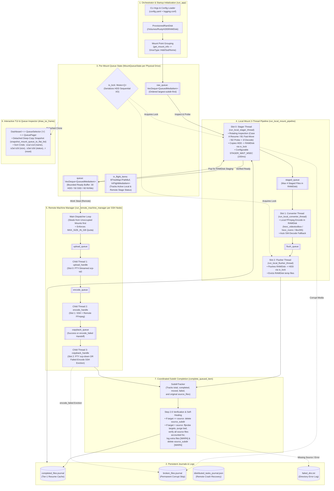
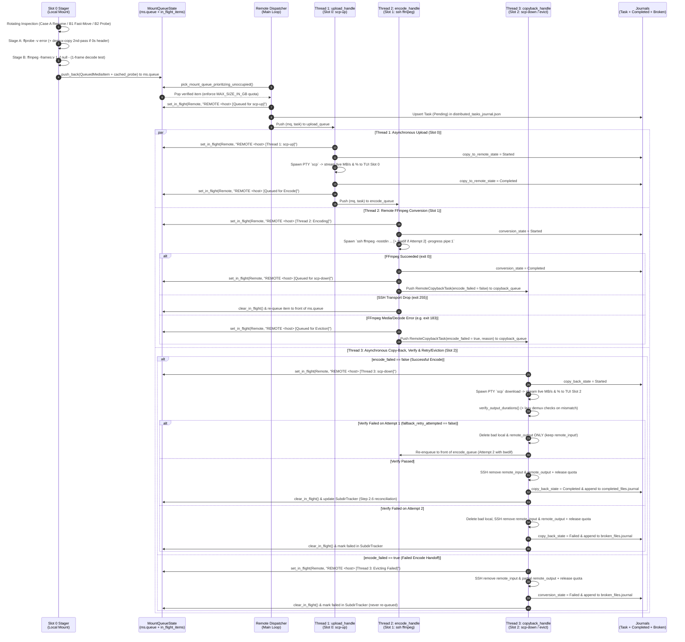
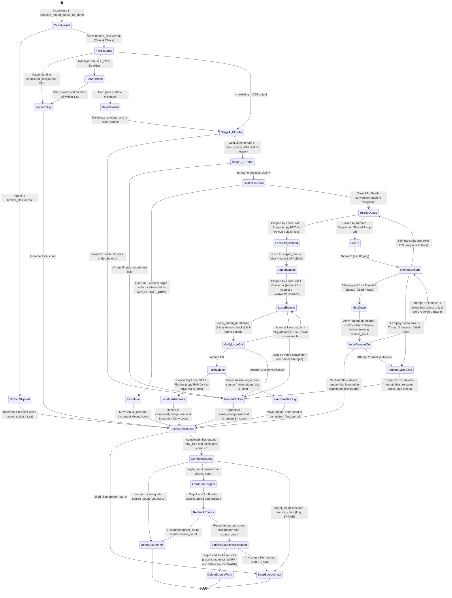
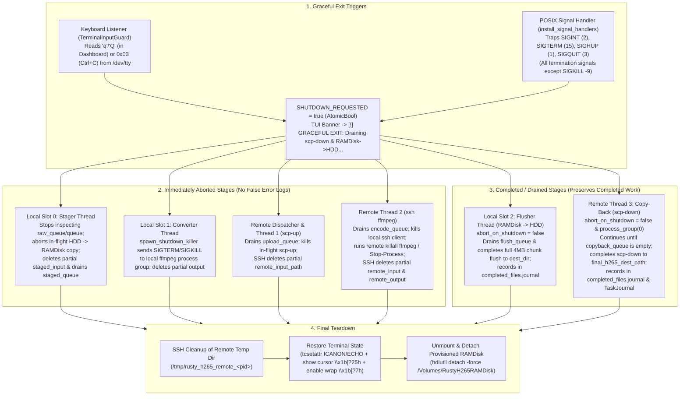
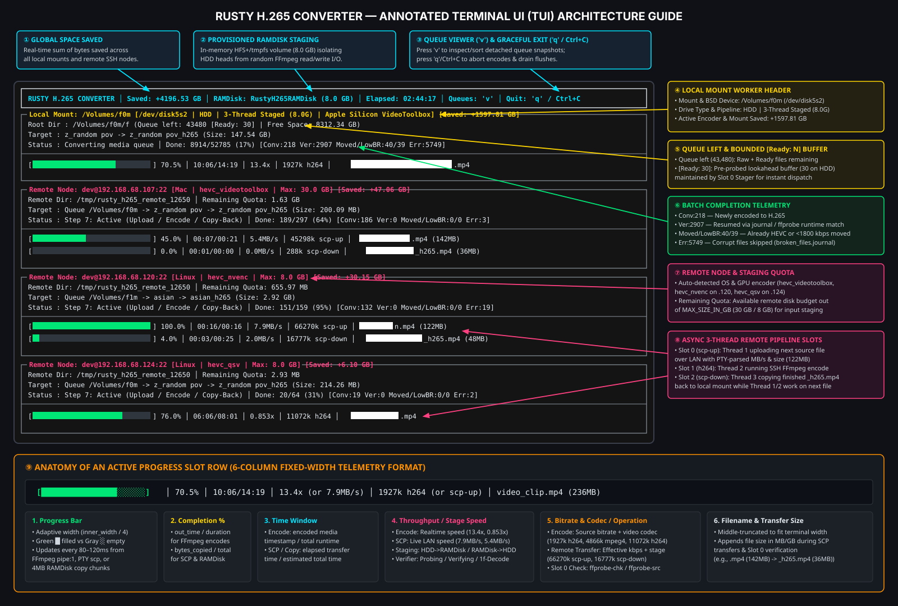
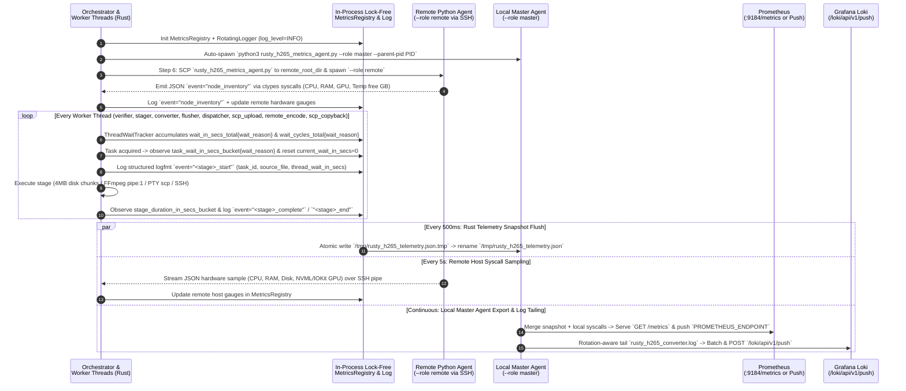
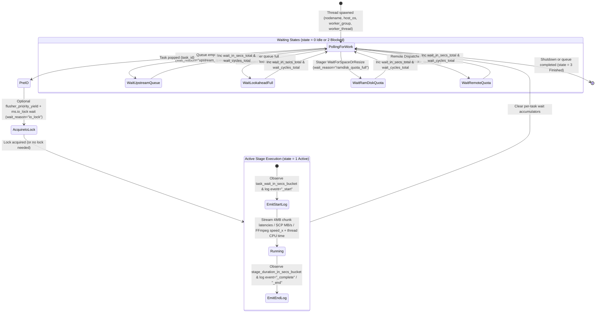

# Rusty H.265 Converter — Software Architecture & Detailed Design

## 1. System Overview & Architectural Goals

[**Rusty H.265 Converter**](../src/main.rs) (`rusty_h265_converter`) is a mount-point-aware, multi-threaded, distributed H.265/HEVC media transcoding orchestrator written in Rust. It coordinates local hardware-accelerated encoders (Apple Silicon `hevc_videotoolbox`, NVIDIA `hevc_nvenc`, and CPU `libx265` via [FFmpeg](https://ffmpeg.org/ffmpeg.html)) alongside remote SSH worker nodes (macOS, Linux, and Windows) while protecting mechanical hard drives (HDDs) from random-I/O thrashing.

### Core Design Principles
* **Mount-Point Isolation & Per-Drive I/O Serialization**: Input directories are grouped by physical filesystem mount point (`statfs` / `df`). Each mount point has its own independent 3-thread local pipeline (`local:<mount_point>`) and dedicated `io_lock` mutex so sequential HDD reads and writes never contend with one another.
* **3-Stage Asynchronous Local Pipeline (`Stager` -> `Converter` -> `Flusher`)**:
  * **Slot 0 (`Stager` — `run_local_stager_thread`)**: Performs rotating queue inspection (`Case A` Tier-1/Tier-2 resume check, `Case B1` fast-move for already-HEVC / low-bitrate files, `Case B2` `ffprobe` + 1-frame decode smoke test), maintains the bounded ready lookahead buffer (`30` on HDD, `50` on SSD, `60` on NVMe), and copies verified files from `HDD -> RAMDisk` (`/Volumes/RustyH265RAMDisk`) into a bounded `staged_queue` (up to `4` staged files), sleeping for `STAGER_WAIT_MSEC` (`config.yaml`, default `150ms`) when waiting on staging capacity or new work.
  * **Slot 1 (`Converter` — `run_local_converter_thread`)**: Pops staged items from `staged_queue`, performs hardware-accelerated decoding and H.265 encoding entirely inside RAMDisk, and pushes finished outputs to `flush_queue`.
  * **Slot 2 (`Flusher` — `run_local_flusher_thread`)**: Pops finished items from `flush_queue`, acquires `ms.io_lock`, flushes the output from `RAMDisk -> HDD` (or moves the original if the encoded file was larger), cleans up RAMDisk temporary files, and updates `completed_files.journal` and `SubdirTracker`.
* **3-Stage Asynchronous Remote Pipeline with Failure Handoff**: Each remote node in [config.yaml](../config.yaml) runs three concurrent child threads (`scp-up` upload, remote `ssh ffmpeg` encode, and `scp-down` copy-back / failed-encode eviction) linked by bounded in-memory queues and backed by `distributed_tasks_journal.json`. When a remote encode fails due to a non-SSH media error, `encode_handle` immediately hands off the failed task (`encode_failed: true`) to `copyback_handle` so `Slot 1` starts the next encode without blocking on SSH cleanup.
* **Interactive TUI Queue Selector (`'v'`) & Detached `less`-Style Queue Viewer**: Users can press `'v'` at any time to browse mount queues, capture a detached deep-copy snapshot (`in_flight_items` + `queue` + `raw_queue`), scroll with `less`-style navigation, and sort by file name (`:s1a`/`:s1d`), size (`:s2a`/`:s2d`), or worker status (`:s3a`/`:s3d`) without blocking worker threads.
* **Three Persistent Journals for Idempotent Resumption**:
  * `completed_files.journal`: Append-only TSV mapping `<source_path>\t<dest_path>\t<dest_size_bytes>` for $O(1)$ Tier-1 resume checks across local and remote workers.
  * `broken_files.journal`: Append-only TSV recording corrupt/unreadable source files (`<source_path>\t<size_bytes>\t<reason>\t<epoch_secs>`) so broken files are never retried in current or future sessions.
  * `distributed_tasks_journal.json`: Structured JSON state tracker for in-flight remote tasks, enabling automatic startup cleanup and re-queueing of interrupted remote jobs.

---

## 2. Diagram 1: Swimlane & Pipeline Topology

*(Standalone file: [01_pipeline_topology.md](01_pipeline_topology.md) | Declarative D2 source: [01_pipeline_topology.d2](01_pipeline_topology.d2) — rendered with [Mermaid Flowcharts](https://mermaid.js.org/syntax/flowchart.html) and [D2](https://d2lang.com/tour/intro/))*

---

## 3. Core Subsystem Design

### 3.1 Mount Discovery, In-Flight Tracking & Queue Ordering (`populate_mount_queue_for_dirs`)
1. **Mount Point Detection (`get_mount_info`)**:
   * Resolves each CLI input directory to its canonical path and queries `df -P` and `diskutil info` (macOS) or `/sys/block/*/queue/rotational` (Linux) to classify the underlying storage as `DriveType::Hdd`, `DriveType::Ssd`, or `DriveType::Nvme`.
2. **Subdirectory Size Sorting & Space Validation**:
   * Scans each root directory for eligible subdirectories (ignoring hidden `.` folders and folders already ending with `_h265`).
   * Computes total byte size per subdirectory and verifies `subdir_size <= available_free_space` on the mount; any subdirectory exceeding free space is logged to `failed_dirs.txt` and skipped.
   * Sorts subdirectories in descending size order (`SORT_BY_SIZE_DESC: true`) so the largest subdirectories are processed first, followed by top-level root directory files (converted in-place).
3. **Subdirectory Tracker (`SubdirTracker`) & In-Flight Map (`in_flight_items`)**:
   * Records `source_files: Vec<PathBuf>` (the complete initial list of source media paths in that subdirectory), `total_files`, `completed_files`, `moved_files`, and `failed_files` in `subdir_trackers`.
   * Maintains `in_flight_items: BTreeMap<PathBuf, InFlightMediaItem>` inside `MountQueueState` so every file popped from `raw_queue` or `queue` by a local thread or remote node remains visible (with its live stage label and worker owner) until completion or failure.

### 3.2 Local 3-Thread Pipeline (`Slot 0` Stager, `Slot 1` Converter, `Slot 2` Flusher)
Each physical mount runs `run_local_mount_pipeline`, which spawns three dedicated threads connected by bounded queues:

1. **Slot 0 — Stager Thread (`run_local_stager_thread` & `inspect_one_raw_item_in_stager`)**:
   * Interleaves two responsibilities in a non-blocking rotation (`stager_prefer_raw_next`):
     * **Responsibility A (Queue Inspection & Bounded Lookahead)**: While `ms.queue.len() < lookahead_limit` (`30` for HDD, `50` for SSD, `60` for NVMe), pops an unverified item from `ms.raw_queue` and executes the 3-case inspection pipeline:
       * **Step 0 — Broken Files Journal Lookup (`is_file_marked_broken`)**: Checks `broken_files.journal` in $O(1)$ time. Known corrupt files are immediately marked failed and skipped without touching the disk.
       * **Case A — Two-Tier Resume Check (`try_resume_existing_h265_output`)**:
         * **Tier 1 (Journal)**: Checks if `<stem>_h265.mp4` or `<stem>_h265.<ext>` exists in `dest_dir` and its byte size matches `completed_files.journal`.
         * **Tier 2 (`ffprobe-chk` Fallback)**: If an output file exists on disk but is not in the journal, displays `ffprobe-chk` (`Verifying`) in `Slot 0` and probes both source and target to confirm a valid video codec and matching runtime (`|src_duration - dst_duration| <= 1.5s`). Valid matches are recorded into `completed_files.journal` and counted under `Ver:<N>`.
       * **Stage A & B Source Validation (`ffprobe -v error` + Demux-Copy Fallback + `verify_first_frame_decodable`)**:
         * Runs `ffprobe -v error` on the source file. If a valid video stream (`video_codec != "unknown"`) and non-zero size are found but header duration is `0.00s` (common in broadcast-flagged / unfinalized WMV/ASF files), Stage A automatically runs a fast **2nd-pass demux-only packet scan** (`probe_duration_via_demux_copy`: `ffmpeg -nostdin -v error -i "<src>" -map 0:v:0 -c copy -f null - -progress pipe:1`) to recover true duration and bitrate without decoding; if packet timestamps are still absent, validity is deferred to Stage B rather than immediately rejecting a playable file.
         * Follows with Stage B: a 1-frame FFmpeg decode test (`ffmpeg -nostdin -v error -i "<src>" -map 0:v:0 -frames:v 1 -f null -`). Any corrupt header, unknown codec, or undecodable bitstream is recorded in `broken_files.journal` and skipped.
       * **Case B1 — Already-Target-Codec or Low-Bitrate Fast Move**:
         * If `video_codec` already matches `TARGET_VIDEO_CODEC` (and container for animated image targets) or `bitrate_kbps < MIN_BITRATE_KBPS` (`1800 kbps`, skipped for animated image targets), acquires `ms.io_lock` and moves the file directly to `<dest_dir>/<stem><OUTPUT_SUFFIX>.<ext>`.
       * **Case B2 — Enqueue to Verified `queue`**:
         * Attaches `cached_probe: Some(probe)` to the `QueuedMediaItem` and pushes it to `ms.queue` (`Ready:<N>`).
     * **Responsibility B (RAMDisk Staging Copy)**: When `staged_queue.len() < LOCAL_STAGED_MAX_ITEMS` (`4`) and RAMDisk has sufficient free bytes (`1.2x` source size + `128 MB` headroom), pops a verified item from `ms.queue`, acquires `ms.io_lock`, copies `HDD -> RAMDisk` with live 4 MB chunk progress in `Slot 0`, and pushes a `LocalStagedTask` into `staged_queue`.
     * **Configurable Idle/Capacity Backoff**: Sleeps for `STAGER_WAIT_MSEC` (`config.yaml`, default `150ms`) whenever waiting for RAMDisk capacity or queue items.
2. **Slot 1 — Converter Thread (`run_local_converter_thread`)**:
   * Pops `LocalStagedTask` items from `staged_queue`, runs hardware-accelerated local FFmpeg encoding (`hevc_videotoolbox`, `hevc_nvenc`, or discovered fallback encoder) entirely inside RAMDisk, validates the output with `verify_output_durations()` + `verify_first_frame_decodable()`, automatically retries once (**Attempt 2**) with software decode + `FFMPEG_FALLBACK_VIDEO_FILTER_ARGS` (`bwdif`) + full audio transcode (`aresample=async=1:first_pts=0`) if Attempt 1 fails encode or duration/A-V sync verification, and pushes a `LocalFlushTask` to `flush_queue`.
3. **Slot 2 — Flusher Thread (`run_local_flusher_thread`)**:
   * Pops `LocalFlushTask` items from `flush_queue`, acquires `ms.io_lock`, flushes the encoded output from `RAMDisk -> HDD` (or moves the original source file if `KEEP_SMALLER_ORIGINAL` is true and the encoded output was larger), cleans up the RAMDisk temporary files, records into `completed_files.journal`, clears `in_flight_items`, and invokes `complete_queued_item` (Step 2.6 subdir reconciliation).

### 3.3 Post-Encode Verification, 2nd-Pass Lazy Demux Checks & Attempt 2 Fallback Retries

Real-world media archives contain container quirks where `ffprobe` headers disagree with actual packet timelines. Rather than blindly loosening tolerances (which would let truncated encodes slip through), `verify_output_durations()` and the local/remote pipelines use **zero-overhead 2nd-pass lazy checks** that trigger *only* when an initial header check flags a mismatch:

| Edge Case | Symptom on 1st Pass | 2nd-Pass Recovery / Handling |
| :--- | :--- | :--- |
| **Headerless / broadcast-flagged WMV/ASF** | `ffprobe` detects `wmv1`/`wmv2` but reports `duration=0.00s`. | Stage A runs a fast `-c copy` demux scan (`probe_duration_via_demux_copy`) to recover true duration & bitrate; if timestamps are still unindexed, defers validity to Stage B 1-frame decode while still enforcing `out_duration > 0` post-encode. |
| **Asymmetric legacy WMV/ASF tracks** | ASF duplicates a single container `Play_Duration` onto both video & audio headers even when true streams differ (e.g., 5s video / 10s audio), causing false `Output A/V stream duration desync`. | When `|out_v - out_a| > AV_STREAM_MISMATCH_TOLERANCE_SECS` on legacy containers (or missing per-stream headers), lazily runs `probe_av_stream_durations_via_demux_copy()` (`0:v:0` and `0:a:0`). Accepts if output faithfully preserves the source's true A/V delta and per-stream spans; rejects genuine introduced drift/truncation. |
| **Wrapped 32-bit 10 MHz MP4 headers (`+429.497s`)** | Buggy 32-bit MP4 muxers wrap `mvhd`/`mdhd` duration modulo $2^{32}/10^7 = 429.4967\text{s}$ (e.g., 683.85s clip reports 254.35s in header). | Right before rejecting a source-vs-output duration mismatch, lazily runs `probe_duration_via_demux_copy(source_path)` to read the true packet timeline. Accepts when output matches true demux duration; still rejects genuine truncations (reporting `[true_source_demux_v=...]`). |
| **Interlaced H.264 / HW-decode glitches (Local & Remote)** | Attempt 1 fails encode or produces 2.0× video duration doubling / A-V desync. | **Local:** Retries Attempt 2 with software decode + `bwdif` (`FFMPEG_FALLBACK_VIDEO_FILTER_ARGS`) + `aresample` audio transcode. **Remote:** `copyback_handle` verifies `verify_output_durations()` *before* deleting `remote_input_path`; on Attempt 1 mismatch, deletes only the bad output, keeps the uploaded input on the remote host (zero re-upload), sets `fallback_retry_attempted = true`, and re-enqueues onto `encode_queue` with `bwdif`. |
| **Audio-less animated outputs (`webp` / `gif`)** | No audio track; `ffprobe` may report `duration=0.00s` for animated images. | Skips A/V sync checks and accepts non-zero-byte outputs with a valid animated video stream. |
| **Corrupt duplicate MP4 edit lists (`elst`)** | Old `mp4creator` files duplicate Track 0's `elst` entry so video loops 2× while audio plays once. | Intentionally **not** auto-overridden via `-ignore_editlist 1` (to avoid breaking legitimate AAC priming, B-frame delay, or QuickTime/iOS trim edit lists); safely quarantined in `broken_files.journal`. |

---

## 4. Diagram 2: Parallel Sequence Diagram (Remote 3-Thread Pipeline, Failure Handoff & Work Stealing)

*(Standalone file: [02_remote_pipeline_sequence.md](02_remote_pipeline_sequence.md) — rendered with [Mermaid Sequence Diagrams](https://mermaid.ai/open-source/syntax/sequenceDiagram.html))*

---

## 5. Diagram 3: Media Item & Subdirectory Reconciliation State Machine

*(Standalone file: [03_media_lifecycle_state_machine.md](03_media_lifecycle_state_machine.md) — rendered with [Mermaid Flowcharts](https://mermaid.js.org/syntax/flowchart.html))*

---

## 6. Diagram 4: Multi-Threaded Execution Timeline & I/O Serialization Waterfall

*(Standalone file: [04_concurrency_timeline_gantt.md](04_concurrency_timeline_gantt.md) — rendered with [Mermaid Timeline / Gantt Syntax](https://mermaid.js.org/syntax/timeline.html); for live execution traces, see [Perfetto UI](https://perfetto.dev/docs/visualization/perfetto-ui))*

```mermaid
gantt
    title Multi-Threaded 3-Stage Local & Remote Pipeline Overlap (HDD Mount + RAMDisk + Remote Node)
    dateFormat  HH:mm:ss
    axisFormat  %S s

    section Local Slot 0 (Stager)
    Inspect & Probe File A (ffprobe + 1f-Decode) :active, v1, 00:00:00, 00:00:01
    File A - Stage Read (HDD to RAMDisk)         :        s0r1, 00:00:01, 00:00:04
    Inspect & Probe File B (ffprobe + 1f-Decode) :active, v2, 00:00:04, 00:00:05
    File B - Stage Read (HDD to RAMDisk)         :        s0r2, 00:00:05, 00:00:08
    Inspect File C (Tier-1 Journal Hit)          :done,   v3, 00:00:08, 00:00:09
    Inspect & Probe File D (Push to Ready Queue) :active, v4, 00:00:09, 00:00:10
    Inspect File E (Corrupt - broken.journal)    :crit,   v5, 00:00:10, 00:00:11
    Inspect & Probe File F (Push to Ready Queue) :active, v6, 00:00:11, 00:00:12

    section HDD io_lock (Mutex)
    File A - HDD to RAMDisk Read (Slot 0)        :crit,   io1, 00:00:01, 00:00:04
    File B - HDD to RAMDisk Read (Slot 0)        :crit,   io2, 00:00:05, 00:00:08
    File A - RAMDisk to HDD Write (Slot 2)       :crit,   io3, 00:00:14, 00:00:16
    File B - RAMDisk to HDD Write (Slot 2)       :crit,   io4, 00:00:24, 00:00:26

    section Local Slot 1 (Converter)
    Wait for First Staged File                   :        s1w, 00:00:00, 00:00:04
    File A - VideoToolbox H.265 Encode (RAMDisk) :active, s1e1, 00:00:04, 00:00:14
    File B - VideoToolbox H.265 Encode (RAMDisk) :active, s1e2, 00:00:14, 00:00:24

    section Local Slot 2 (Flusher)
    Idle (Waiting on flush_queue)                :        s2w, 00:00:00, 00:00:14
    File A - Flush Write (RAMDisk to HDD)        :        s2f1, 00:00:14, 00:00:16
    File B - Flush Write (RAMDisk to HDD)        :        s2f2, 00:00:24, 00:00:26

    section Remote Node (3 Threads)
    File D - Thread 1 scp-up (LAN to Remote)     :        ru1, 00:00:10, 00:00:14
    File F - Thread 1 scp-up (LAN to Remote)     :        ru2, 00:00:14, 00:00:18
    File D - Thread 2 Remote FFmpeg Encode       :active, re1, 00:00:14, 00:00:22
    File F - Thread 2 Remote FFmpeg Encode       :active, re2, 00:00:22, 00:00:30
    File D - Thread 3 scp-down (Remote to LAN)   :        rd1, 00:00:22, 00:00:25
    File F - Thread 3 scp-down (Remote to LAN)   :        rd2, 00:00:30, 00:00:33
```

### Key Concurrency Insights Shown Above
1. **Decoupled 3-Stage Local Overlap with Zero HDD Collisions**: `Slot 0 (Stager)` stages `File B` into RAMDisk (`5–8s`) while `Slot 1 (Converter)` is simultaneously encoding `File A` in RAMDisk (`4–14s`), and `Slot 1` encodes `File B` (`14–24s`) while `Slot 2 (Flusher)` flushes `File A` from `RAMDisk -> HDD` (`14–16s`). All physical disk reads (`Slot 0`) and writes (`Slot 2`) serialize cleanly through `ms.io_lock`.
2. **Remote Pipeline Overlap**: On the remote node, Thread 1 (`scp-up`) uploads `File F` (`14–18s`) *at the exact same time* Thread 2 (`encode_handle`) is encoding `File D` (`14–22s`), and Thread 2 begins encoding `File F` (`22–30s`) *at the exact same time* Thread 3 (`copyback_handle`) is downloading `File D` (`22–25s`).

---

## 7. Diagram 5: Graceful Shutdown & Signal Handling Architecture

*(Standalone file: [05_graceful_shutdown_flow.md](05_graceful_shutdown_flow.md) — rendered with [Mermaid Flowcharts](https://mermaid.js.org/syntax/flowchart.html))*

### Graceful Shutdown Behavior Matrix

| Subsystem / Stage | Action on `'q'` / `Ctrl+C` / `SIGTERM` | Partial Files Cleaned Up? | Logged to `failed_dirs.txt` or `broken_files.journal`? | Updates `completed_files.journal`? |
| :--- | :--- | :--- | :--- | :--- |
| **Local `Slot 0` Stager** | Exits inspection & aborts `HDD -> RAMDisk` copy (`abort_on_shutdown = true`); drains `staged_queue` | **Yes** (`staged_input` removed) | **No** | **No** |
| **Local `Slot 1` Converter (`ffmpeg`)** | Killed immediately via `spawn_shutdown_killer` (`SIGTERM` -> `SIGKILL`) | **Yes** (`staged_output` removed) | **No** | **No** |
| **Local `Slot 2` Flusher (`RAMDisk -> HDD`)** | **Allowed to finish completely** (`abort_on_shutdown = false`) | **Yes** (`staged_output` removed after flush) | **No** | **Yes** |
| **Remote `scp-up` Upload** | Aborts immediately (`abort_on_shutdown = true`); drains `upload_queue` | **Yes** (remote partial input deleted via SSH) | **No** | **No** |
| **Remote `ssh ffmpeg` Encode** | Kills local `ssh` & remote `ffmpeg`; drains `encode_queue` | **Yes** (remote input & output deleted via SSH) | **No** | **No** |
| **Remote `scp-down` Copy-Back** | **Allowed to finish all in-flight & queued items** (`abort_on_shutdown = false`) | **Yes** (remote files deleted after download) | **No** | **Yes** |

---

## 8. Terminal UI (TUI) Architecture, Interactive Queue Viewer & Design Decisions

*(Standalone guide: [06_tui_annotated_guide.md](06_tui_annotated_guide.md) | Annotated Vector Diagram: [06_tui_annotated_guide.svg](06_tui_annotated_guide.svg))*

### 8.1 Annotated TUI Field Reference (`Dashboard` Mode)

#### ①–③ Top Global Banner (`╔═══...═══╗`)
* **Application Title (`RUSTY H.265 CONVERTER`)**: Displays the active orchestrator mode in bold cyan (`\x1b[1;36m`). When `'q'` or `Ctrl+C` (`SIGINT`/`SIGTERM`/`SIGHUP`/`SIGQUIT`) is triggered, the entire banner switches to bold yellow (`\x1b[1;33m`) and displays `[!] GRACEFUL EXIT: Draining scp-down & RAMDisk->HDD...`.
* **① `Saved: +4196.53 GB`**: Real-time sum of disk space saved (`source_size - encoded_size`) across all local mounts and remote SSH nodes (`sum(w.bytes_saved_total)`).
* **② `RAMDisk: RustyH265RAMDisk (8.0 GB @ /Volumes/RustyH265RAMDisk)`**: Shows the provisioned in-memory staging volume name, capacity, and mount point (or `Staging: <path>` / `Staging: Disabled` if RAMDisk is disabled).
* **③ `Elapsed: 02:44:17` | `Queues: 'v'` | `Quit: 'q' / Ctrl+C`**: Total wall-clock runtime since startup, shortcut to open the interactive Queue Selector (`'v'`), and graceful-shutdown keybind reminder (`'q'` / `Ctrl+C`).

#### ④–⑥ Local Mount Worker Box (Yellow Header — `local:<mount_point>`)
Each physical filesystem mount point (`/Volumes/f0m`, `/Volumes/f1m`) is rendered in its own isolated box:
* **④ Box Header (`Local Mount: /Volumes/f0m [/dev/disk5s2 | HDD | 3-Thread Staged (8.0G) | Apple Silicon VideoToolbox] [Saved: +1597.81 GB]`)**:
  * **Mount Point & BSD Device**: Physical mount path (`/Volumes/f0m`) and underlying block device (`/dev/disk5s2`).
  * **Drive Type & 3-Thread Staging Mode**: Auto-detected media class (`HDD`, `SSD`, or `NVMe`) and active 3-thread staging configuration (`3-Thread Staged (8.0G)` or `3-Thread NVMe-Staged`).
  * **Hardware Encoder Profile**: Active local encoder (`Apple Silicon VideoToolbox`, `NVIDIA NVENC`, or `CPU libx265`).
  * **`[Saved: +1597.81 GB]`**: Cumulative disk space saved on this specific mount point.
* **⑤ `Root Dir: /Volumes/f0m/f (Queue left: 43480 [Ready: 30] | Free Space: 8312.34 GB)`**:
  * **`Queue left: 43480`**: Total remaining items (`raw_queue.len() + queue.len()`) waiting to be processed on this mount.
  * **`[Ready: 30]`**: Current number of pre-verified items in the bounded lookahead buffer (`ms.queue`), maintained by the per-mount `Slot 0` Stager (`30` max on HDD, `50` on SSD, `60` on NVMe) so encoders and remote workers never stall waiting on disk probes.
  * **`Free Space: 8312.34 GB`**: Live available space on the mount point (`statfs`).
* **`Target: z_random pov -> z_random pov_h265 (Size: 147.54 GB)`**: Current source subdirectory being converted into its `_h265` counterpart and total byte size of that source subdirectory.
* **⑥ `Status: Converting media queue | Done: 8914/52785 (17%) [Conv:218 Ver:2907 Moved/LowBR:40/39 Err:5749]`**:
  * **`Done: 8914/52785 (17%)`**: Completed files over total discovered files for this worker, with completion percentage.
  * **`Conv:218`**: Files newly encoded to H.265 `.mp4`.
  * **`Ver:2907`**: Existing `_h265` files verified and skipped via Tier-1 (`completed_files.journal`) or Tier-2 (`ffprobe` runtime match).
  * **`Moved/LowBR:40/39`**: Source files that were already HEVC (`40 - 39 = 1`) or already below `MIN_BITRATE_KBPS` (`39`) and were fast-moved without re-encoding.
  * **`Err:5749`**: Corrupt/unreadable media files caught by `Slot 0` (`ffprobe -v error` or 1-frame decode test) or worker encode and recorded in `broken_files.journal`.
* **Asynchronous 3-Thread Local Pipeline Slots (`0..2`)**:
  * **Slot 0 (`Stager`)**: Rotating queue inspection (`ffprobe-chk`, `ffprobe-src`, `1f-Decode`, fast-move) and `HDD -> RAMDisk` staging copy.
  * **Slot 1 (`Converter`)**: Hardware-accelerated local FFmpeg H.265 encode in RAMDisk.
  * **Slot 2 (`Flusher`)**: Sequential `RAMDisk -> HDD` write-back under `io_lock`.

#### ⑦–⑧ Remote Node Worker Box (Magenta Header — `remote:<user>@<ip>`)
Each configured remote SSH host (`192.168.68.107`, `192.168.68.120`, `192.168.68.124`) is rendered in its own box:
* **⑦ Box Header (`Remote Node: dev@192.168.68.120:22 [Linux | hevc_nvenc | Max: 8.0 GB] [Saved: +30.15 GB]`)**:
  * Displays the SSH endpoint, detected remote OS (`Mac`, `Linux`, `Windows`), startup-verified hardware HEVC encoder (`hevc_videotoolbox`, `hevc_nvenc`, `hevc_qsv`), configured input staging cap (`Max: 30.0 GB` / `Max: 8.0 GB`), and cumulative bytes saved by this remote node.
* **⑦ `Remote Dir: /tmp/rusty_h265_remote_12650 | Remaining Quota: 655.97 MB`**:
  * Shows the PID-scoped remote staging directory and the remaining byte quota (`MAX_SIZE_IN_GB - remote_used_input_bytes`) available for staging new uploads.
* **`Target: Queue /Volumes/f1m -> asian -> asian_h265 (Size: 2.92 GB)`**:
  * Indicates which local mount queue (`/Volumes/f0m` or `/Volumes/f1m`) and subdirectory the remote dispatcher stole its current task from, along with the task's source file size.
* **⑧ Asynchronous 3-Thread Pipeline Slots**:
  * **Slot 0 (`scp-up`)**: Thread 1 uploading the next source video over LAN (`45.0% | 00:07/00:21 | 5.4MB/s | 45298k scp-up | ...mp4 (142MB)`).
  * **Slot 1 (`h264` / `mpeg4`)**: Thread 2 running remote hardware FFmpeg over SSH (`76.0% | 06:06/08:01 | 0.853x | 11072k h264 | ...mp4`).
  * **Slot 2 (`scp-down` / `rm-failed`)**: Thread 3 downloading the finished H.265 file back to the local mount (`4.0% | 00:03/00:25 | 2.0MB/s | 16777k scp-down | ..._h265.mp4 (48MB)`), or evicting remote temp files on `encode_failed` handoff.

#### ⑨ Active Slot Progress Row Format (6-Column Fixed-Width Layout)
Every active slot row inside both Local and Remote boxes shares a single 6-column layout:
1. **`[████░░]` Progress Bar**: Scaled dynamically to `(inner_width / 4).clamp(16, 48)`.
2. **`70.5%` Percentage**: `out_time_secs / total_duration_secs` (for FFmpeg) or `bytes_transferred / total_bytes` (for SCP and RAMDisk copies).
3. **`10:06/14:19` Time Window**: Encoded media timestamp vs. total video duration (for FFmpeg), or elapsed transfer time vs. estimated total transfer time (for SCP and RAMDisk I/O).
4. **`13.4x` / `7.9MB/s` Speed Column**: Real-time speed multiplier (`13.4x`) for FFmpeg encodes, live transfer rate (`7.9MB/s`) for SCP, disk direction + rate (`HDD->RAMDisk 185M/s`, `RAMDisk->HDD 210M/s`) for local staging/flushing, or `Verifying` / `Probing` / `Validating` / `Moving` for `Slot 0`.
5. **`1927k h264` / `66270k scp-up` Bitrate & Codec / Operation**: Source video bitrate and codec during encoding, effective transfer kbps and stage (`scp-up` / `scp-down`) during network transfers, or `ffprobe-chk` / `ffprobe-src` during `Slot 0` checks.
6. **`filename.mp4 (142MB)` Filename & Byte Size**: Middle-truncated (`truncate_middle`) using terminal display-column width (`str_display_width`) so long paths never wrap lines, with file size (`142MB` -> `36MB`) appended for transfer and verification visibility.

---

### 8.2 Interactive Queue Selector (`'v'`) & `less`-Style Sortable Queue Viewer (`QueuePager`)

1. **Three-Mode State Machine (`TuiViewMode`)**:
   * **`Dashboard`**: Default real-time telemetry view. Pressing `'v'` or `'V'` transitions to `QueueSelector`.
   * **`QueueSelector`**: Dropdown selector showing each mount point, `DriveType`, root directory, active in-flight count, queued count (`[Ready: N]`), and total size in GB. Navigate with `Up`/`Down`, `j`/`k`, or `1`–`9`, press `Enter` to inspect a queue, or `Esc`/`v`/`q` to return to `Dashboard`.
   * **`QueuePager`**: `less`-style scrollable and sortable table displaying a detached deep-copy snapshot of the chosen mount queue.
2. **Detached Deep-Copy Snapshot (`snapshot_mount_queue_to_flat_list`)**:
   * Entering a queue briefly locks `MountQueueState`, clones `in_flight_items`, `queue` (verified ready items), and `raw_queue` (unprobed items), and flattens them into an isolated `Vec<QueueViewEntry>` inside `QueueSnapshotView`.
   * Displays a human-friendly header summary with millisecond timestamp:
     `Queue of files from root: /Volumes/f1m/f at 8:43:38.709 pm. Total: 4304 files (62 active, 4242 queued | 1155.62 GB)`
   * Renders 3 columns: `[1] File Name / Path`, `[2] Size`, and `[3] Status / Worker` (`LOCAL [...]`, `REMOTE <host> [...]`, `QUEUED [Ready]`, `QUEUED [Pending Probe]`).
   * Supports `less`-style navigation (`Up`/`Down`, `j`/`k`, `PgUp`/`PgDn`, `Space`/`b`, `u`/`d`, `g`/`G`), snapshot refresh (`r`), and vim-style sort commands (`:s1a`, `:s1d`, `:s2a`, `:s2d`, `:s3a`, `:s3d`, and `:r` to reset to original queue order).

---

### 8.3 Key TUI Engineering & Design Decisions

1. **Decoupled Snapshot State (`Arc<Mutex<BTreeMap<String, WorkerUiSnapshot>>>`)**:
   * Worker threads (`Slot 0` Stager, `Slot 1` Converter, `Slot 2` Flusher, and remote upload/encode/copy-back threads) never write directly to `stdout`. Instead, they update their slot entry in a shared `BTreeMap<String, WorkerUiSnapshot>` throttled to `80–120ms` intervals, while a dedicated TUI render thread (`120ms` tick) locks the snapshot map briefly, builds the entire frame in a single `String` buffer, and flushes it in one atomic `stdout.lock()` write.
   * Using a `BTreeMap` keyed by `"local:<mount>"` and `"remote:<user>@<ip>"` guarantees deterministic vertical ordering of boxes across every frame.
2. **Anti-Scrolling Cursor Home (`\x1b[H` + `\x1b[J`), Auto-Wrap Suppression (`\x1b[?7l`), & Mode-Transition Clears**:
   * `draw_tui_frame` queries `(ws_col, ws_row)` via `ioctl(TIOCGWINSZ)` on every frame, reserves a 1-column right margin (`box_width = raw_cols.saturating_sub(1).max(60)`), disables terminal auto-wrap (`\x1b[?7l`, restored via `\x1b[?7h` on exit/panic), and clamps rendered output to `max_visible_rows = ws_row - 1`.
   * Whenever the view mode (`Dashboard` / `QueueSelector` / `QueuePager`) or terminal dimensions change, `draw_tui_frame` emits a full screen clear (`\x1b[2J\x1b[H`) so no stale borders or rows remain on screen.
3. **Plain-Text ANSI Formatting & Display-Column Width Calculation (`str_display_width`)**:
   * All TUI status labels, sort indicators (`(ASC)` / `(DESC)`), and banners use pure plain text with ANSI color styling (zero emojis), and `pad_or_truncate` / `truncate_middle` measure strings by terminal display columns (`char_display_width`) so wide Unicode characters in media filenames never overflow box borders.
4. **Live PTY Progress Extraction for `scp-up` and `scp-down`**:
   * Standard `scp` suppresses its progress meter when `stdout` is not a TTY. On macOS, `run_scp_with_live_tui_progress` wraps `scp` inside `script -q /dev/null scp ...` (with `stdin` redirected to `/dev/null` and isolated in its own process group `process_group(0)`), parses carriage-return (`\r`) progress frames in real time via `parse_scp_progress_line`, and supplements it with local file growth polling during `scp-down` so network transfers animate smoothly alongside [FFmpeg](https://ffmpeg.org/ffmpeg.html) `-progress pipe:1` encodes.
5. **Non-Blocking Raw-Mode `/dev/tty` Input (`TerminalInputGuard`)**:
   * `TerminalInputGuard` opens `/dev/tty`, disables `ICANON` and `ECHO` via `tcsetattr` with a `100ms` read timeout (`VMIN = 0, VTIME = 1`), parses single-key commands and multi-byte ANSI escape sequences (arrow keys, `PgUp`/`PgDn`, `Home`/`End`, or standalone `Esc`), and automatically restores the original `Termios` state, cursor visibility (`\x1b[?25h`), and line wrap (`\x1b[?7h`) via Rust's `Drop` trait on exit.

---

## 9. Diagram 7: Observability Architecture — Prometheus Metrics, Per-Thread Wait Tracking & Grafana Loki Log Shipping

*(Standalone guide & diagrams: [07_observability_telemetry_and_loki.md](07_observability_telemetry_and_loki.md))*

### 9.1 Distributed Observability Overview (`rusty_h265_converter` + `rusty_h265_metrics_agent.py`)
1. **In-Process Lock-Free Telemetry (`MetricsRegistry` & `ThreadWaitTracker`)**:
   * Every worker thread (`verifier`, `stager`, `converter`, `flusher` on local mounts, and `remote_dispatcher`, `scp_upload`, `remote_encode`, `scp_copyback` on remote managers) tracks its USE, RED, and Four Golden Signals metrics in memory using lock-free `AtomicU64` counters and fixed-bucket histograms.
   * Each thread owns a `ThreadWaitTracker` that measures pre-task and in-task wait durations broken down by `wait_reason` (`upstream_queue_empty`, `ramdisk_quota_full`, `remote_quota_full`, `lookahead_buffer_full`, `flusher_priority_yield`, `io_lock`).
   * The orchestrator assigns a single global monotonic `task_id` (`1..N`) to every discovered media file and flushes `/tmp/rusty_h265_telemetry.json` atomically (`tmp -> rename`) every `MONITOR_INTERVAL_MSEC` (`500ms`).
2. **Symmetric Structured `logfmt` Logging (`rusty_h265_converter.log`)**:
   * Both local and remote 3-stage pipelines emit the exact same lifecycle event names (`verify_file_start`/`verify_file_complete`, `stage_file_start`/`stage_file_complete`, `conversion_start`/`conversion_end`, `flush_start`/`flush_end`) with human-readable units (`source_file_size_in_mb`, `target_file_size_in_mb`, `storage_saved_in_mb`, `compression_ratio`, `thread_wait_in_secs`, `stage_duration_in_secs`, `conversion_duration_in_secs`, `flush_duration_in_secs`, `quota_used_gb`, `quota_remaining_gb`).
   * Every log line and every Prometheus metric shares the exact same low-cardinality label set (`nodename`, `host_os`, `worker_group`, `worker_thread`, `mount_point`) for 1-to-1 Grafana correlation between Prometheus panels and Loki LogQL streams.
3. **Portable Python Observability Agent (`scripts/rusty_h265_metrics_agent.py`)**:
   * **Remote Role (`--role remote`)**: Copied via `scp` into each remote worker node's temporary directory at Step 6 startup. Samples remote CPU, RAM, temp disk free space (`os.statvfs` / `GetDiskFreeSpaceExW`), and GPU utilization (`NVML` via `ctypes` for GPU/NVENC/NVDEC/VRAM/temp/power on Windows/Linux, and `IOKit` `IOAccelerator` on macOS) every 5s using direct in-process OS/C-library syscalls, streaming JSON telemetry lines over the persistent SSH pipe.
   * **Local Master Role (`--role master`)**: Auto-spawned by `rusty_h265_converter` at startup. Merges `/tmp/rusty_h265_telemetry.json` with local OS/GPU syscall samples, serves `GET /metrics` on `PROMETHEUS_LISTEN_ADDR` (and/or pushes to `PROMETHEUS_ENDPOINT`), and runs a rotation-aware log tailer on `rusty_h265_converter.log` that batches and ships structured log streams to Grafana Loki (`POST LOKI_ENDPOINT`).

### 9.2 Sequence Diagram: End-to-End Logging & Metrics Collection

### 9.3 State-Machine Diagram: Per-Thread Wait-Time & Stage Execution (`ThreadWaitTracker`)

---

## 10. Configuration & File Reference

* **Primary Implementation**: [src/main.rs](../src/main.rs) & [src/telemetry.rs](../src/telemetry.rs)
* **Portable Python Observability Agent**: [scripts/rusty_h265_metrics_agent.py](../scripts/rusty_h265_metrics_agent.py)
* **Unit Test Suite**: [src/tests.rs](../src/tests.rs)
* **Runtime Configuration**: [config.yaml](../config.yaml) (includes `LOCAL.NODENAME`, `WORKER_NODES[].NODENAME`, `STAGER_WAIT_MSEC`, `PROMETHEUS_*`, and `LOKI_*` settings)
* **Rotating Logger Configuration**: [logging.conf](../logging.conf)
* **Standalone Architecture Diagrams & Guides**:
  1. [01_pipeline_topology.md](01_pipeline_topology.md) ([01_pipeline_topology.d2](01_pipeline_topology.d2))
  2. [02_remote_pipeline_sequence.md](02_remote_pipeline_sequence.md)
  3. [03_media_lifecycle_state_machine.md](03_media_lifecycle_state_machine.md)
  4. [04_concurrency_timeline_gantt.md](04_concurrency_timeline_gantt.md)
  5. [05_graceful_shutdown_flow.md](05_graceful_shutdown_flow.md)
  6. [06_tui_annotated_guide.md](06_tui_annotated_guide.md) ([06_tui_annotated_guide.svg](06_tui_annotated_guide.svg))
  7. [07_observability_telemetry_and_loki.md](07_observability_telemetry_and_loki.md)
